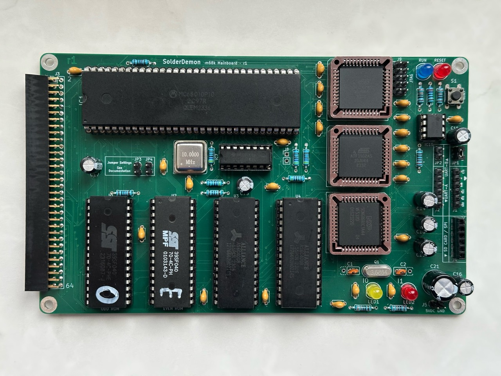

# SolderDemon m68k

<!-- repository-layout -->
## Repository layout

- [`design/`](design/solderdemon_m68k.kicad_pro): KiCad project, schematic sheets, PCB, local libraries and design data. Open the project directly here.
- [`code/firmware/`](code/firmware/): ROM and programmable-logic sources and programming files.
- [`code/software/`](code/software/): drivers, examples and applications.
- [`code/build/`](code/build/): local build products; ignored by Git except for its README.
- [`tools/`](tools/): generators, simulations and export scripts. Run commands from the repository root unless stated otherwise.
- [`manufacturing/`](manufacturing/): fabrication packages.

Programmable-logic files are in `code/firmware/pld/`. Native CPLD tools retain their adjacent `bin/` outputs.
Design files and documentation are generated by scripts in `tools/`; change the sources and regenerate. Keep `.kicad_pro` as the source of DRC rules.
<!-- /repository-layout -->

SolderDemon develops a line of Motorola 68k computers built from **through-hole (THT) parts**. This repository holds its mainboard: the board design, firmware, software and CPLD code. Expansion boards such as the [busboard](https://github.com/solderdemon/solderdemon_m68k-busboard) plug into its J3 expansion connector.

The mainboard is built on [rosco_m68k](https://github.com/rosco-m68k/rosco_m68k) by Ross Bamford, The Really Old-School Company Limited, and contributors. SolderDemon boards carry their own revision numbers, starting at r1; the rosco r2.x numbers are the history they grew from. The photo above shows the assembled SolderDemon m68k r1 mainboard.

## The board: r1

r1 is the current through-hole prototype. KiCad renders of it, top and bottom:

The current PCB and factory files use 23 radial ceramic 100 nF capacitors with 5.08 mm
lead spacing. The renders below predate that footprint change; use the current KiCad board
for placement and hole positions.

  
  

| | |
| --- | --- |
| CPU | MC68010, 10 MHz |
| Memory | 1 MB Flash ROM (2 × SST39SF040), 1 MB SRAM (2 × AS6C4008) |
| Glue logic | 2 × ATF1502AS CPLD in PLCC-44 sockets, programmed in circuit over JTAG (J9) |
| I/O | XR68C681 DUART: two UARTs (J1, J2), SD card over SPI (J4) |
| Expansion | 64-pin J3 connector |
| PCB | 165 × 100 mm, 4 layers |

What changed from rosco r2.42 is in the [design notes](design/README.md).

Production [CPLD firmware](code/firmware/pld/cpld/README.md) uses the r1.1 address-based ROM handoff for reliable startup. Use `code/firmware/pld/cpld/bin/ic2_decoder.jed` for IC2 and `code/firmware/pld/cpld/bin/ic3_glue.jed` for IC3; the ROM Flash image is unchanged.
The [r1 first-order sheet](docs/ORDER_R1.md) links the factory ZIP and check reports for a
five-board prototype run.

## Find your way around

| What you need | Where to go |
| --- | --- |
| Board design | [design](design/README.md) |
| BOM, jumper settings, memory map, and expansion pinout | [docs](docs/README.md) |
| Firmware and ROM code | [code/firmware](code/firmware) |
| PLD source and programming | [PLD guide](code/firmware/pld/README.md) |
| Software, libraries, and examples | [code/software](code/software) |
| Recommended software workflow | [rosco CLI and Docker guide](docs/development.md) |
| Emulator for rosco_m68k and rosco_6502 | [SolderDemon rosco-emulator](https://github.com/solderdemon/rosco-emulator) |

## Develop software

For new programs, use [rosco CLI](https://github.com/solderdemon/rosco-cli) with its Docker build workflow. It creates the current starter project, builds through Docker, and can upload and monitor over UART. Follow the [quick start](docs/development.md).

## At the bench

- Start with the [hardware build guide](design/README.md) and [bill of materials](docs/BOM.md).
- Check [power and jumper settings](docs/JUMPERS.md) before applying power, particularly JP1/JP2 for FTDI power and JP3 for Flash writes.
- Use the [J3 expansion header pinout](docs/EXPANSION.md) for peripherals. J3 is the header; JP3 is a different, two-pin jumper.
- For code builds, see the [firmware and software overview](code/README.md). The [older SD card guide](docs/legacy-sd-card.md) covers earlier board revisions and is kept for code users.

Photos from the project's early prototypes

These images show early project prototypes.

## Licences and attribution

- **Hardware:** [CERN Open Hardware Licence v1.2](LICENCE.hardware.txt).
- **Software:** [MIT](LICENSE), with [third-party notices](licenses/README.md).
- **Documentation:** [Creative Commons Attribution 4.0](licenses/LICENSE.docs).

Based on [rosco_m68k](https://github.com/rosco-m68k/rosco_m68k) by Ross Bamford, The Really Old-School Company Limited, and contributors. SolderDemon changes include the through-hole mainboard layout, CPLD logic, board identity and build documentation. Original authorship and licence notices are retained.
